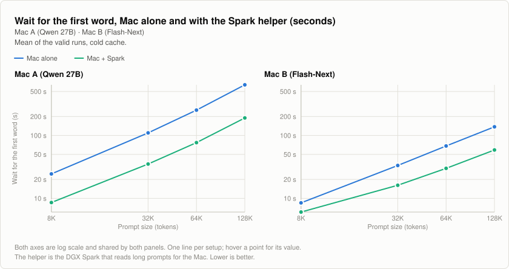

# Does a DGX Spark make a Mac faster?

Yes, for long prompts. On Mac A a 128K-token prompt (about 100,000 words) waits 10.6 min on the Mac
alone and 3.2 min with the Spark. On Mac B the same prompt waits 2.3 min alone and 58.8 s with the
Spark.

## The two test setups

- **Mac A** is an Apple M3 Ultra with 256 GB of memory, running Qwen 27B, a large model.
- **Mac B** is the same Mac hardware, running Flash-Next, a model that only uses part of itself for
  each word, so it is faster on its own.
- **The Spark** is an NVIDIA DGX Spark, a small computer that reads long prompts for the Mac.
- **oMLX** is the server that runs the model on the Mac. It is the work of its own authors: see
  [the oMLX project](https://github.com/jundot/omlx). The Spark runs the oMLX CUDA helper.

<!-- BEGIN GENERATED: headline -->
<picture>
  <source media="(prefers-color-scheme: dark)" srcset="charts/headline-dark.svg">
  
</picture>

#### Mac A (Qwen 27B)

| Prompt size | Mac alone | Mac + Spark | Faster by |
|---|---:|---:|---:|
| 8K | 24.5 s | 8.6 s | 2.8× |
| 32K | 109.8 s | 35.1 s | 3.1× |
| 64K | 252.8 s (4.2 min) | 76.9 s | 3.3× |
| 128K | 638.1 s (10.6 min) | 189.8 s (3.2 min) | 3.4× |

#### Mac B (Flash-Next)

| Prompt size | Mac alone | Mac + Spark | Faster by |
|---|---:|---:|---:|
| 8K | 8.5 s | 6.1 s | 1.4× |
| 32K | 33.3 s | 16.1 s | 2.1× |
| 64K | 68.0 s | 30.0 s | 2.3× |
| 128K | 137.2 s (2.3 min) | 58.8 s | 2.3× |

- Mac alone is the Mac on its own; Mac + Spark is the same Mac with the Spark helper reading the prompt at the same time.
- Every figure is the mean of the valid runs of that Mac's speed study, each run with a cold cache (the server held none of the prompt).
<!-- END GENERATED: headline -->

## When it helps, and when it does not

- **Long prompts gain most.** Mac A gets 3.4 times faster at 128K tokens. Mac B gets 2.3 times faster
  at the same size. See [speed](docs/speed.md).
- **Short prompts gain little.** At 1K tokens Mac B gains 1.1 times, and 1.4 times at 8K.
- **The faster Mac gains less.** Mac B reads a prompt fast on its own, so the Spark takes off less
  there: 1.4 to 2.3 times, against 2.8 to 3.4 times on Mac A.
- **Many people at once still helps.** On Mac B at 32K, eight users at the same moment wait 5.4 min
  alone and 2.5 min with the Spark. See [many users](docs/many-users.md).

## Does it change the answers?

Mostly no, and the test shows less than it seems. The Spark and the Apple Neural Engine only act on
long prompts. The grade-school maths questions (GSM8K) and general-knowledge questions (MMLU) are
about 150 tokens, too short for the Spark or the Neural Engine to do any work, so their rows show no
change because nothing happened. We checked this from the times. We did not check the server log.

The Spark was tested on the 6 long passkey prompts only (find a hidden number in a long text), and
got all 6 right. On Mac A, 10 or 11 of 700 answers changed against Mac alone even where the add-on did
no work, so changes that small happen on their own. On Mac B no setting changed an answer on this run
(0 of 700 answers); that is not a measured safety margin. The numbers are in
[answer quality](docs/answer-quality.md).

## What you need

- An Apple silicon Mac. Tested: M3 Ultra with 256 GB of memory. The most memory a run used was
  29.1 GB at 128K on Mac A, and 108.5 GB at 128K on Mac B. Both Macs here have 256 GB.
- An NVIDIA DGX Spark as the helper. Tested: the 128 GB model.
- A fast network link between the two. Tested: a 10 gigabit link.
- oMLX 0.8.0rc1 on the Mac: the server that runs the model and answers each prompt, from
  [the oMLX project](https://github.com/jundot/omlx).
- The oMLX CUDA helper 0.1.4 on the Spark. This repository does not cover setting up the helper; see
  the oMLX helper's own guide.
- One language model on the Mac. Tested: the Qwen 27B model, an open language model, stored as
  `Jundot/Qwen3.8-27B-oQ4e-mtp` (4-bit, 16 GB on disk); and the Flash-Next model, a second open
  language model, stored as `Qwen3.8-Flash-Next-oQ4e-mtp`.
- One fix the helper still needs: the 128K prompt fails on the stock helper. The fix is in
  [pull request 5271](https://github.com/jundot/omlx/pull/5271), and it is not in a release yet.

## Try it on your Mac

The repository is called omlx-fleet-bench:
[github.com/GumbiiDigital/omlx-fleet-bench](https://github.com/GumbiiDigital/omlx-fleet-bench).

Python 3.9 or newer, and no extra Python packages to install. One command runs a whole test file on
your own server, and a second builds a summary from the rows. A settings change makes your server
unload and load the model again, so try it on a server only you use.

The run puts your settings back, uploads nothing and never prints your key. Every step is in
[run it](docs/run-it.md).

## Can I trust these numbers?

- Two Macs only, one model on each, on a pre-release build of oMLX. We do not know how far these
  numbers carry to other Macs, other models or other builds.
- Every run read its prompt with a cold cache: the server held nothing of the prompt. There is no
  warm-cache test. The only warm result is two helper runs, at 8K and 32K, run again back to back.
- Each figure in the picture is the mean of 3 runs; the prompt-size test on Mac B has 2 runs per size.
  Three runs are enough to see a 3 times change, not enough to rank two setups that are 2% apart.
- One test sends many requests at once. Every other test sends one request at a time.
- Each Mac had its own Spark beside it. The prompt-size test used a second Spark of the same type, a
  day earlier.
- The Flash-Next server refused a 256K prompt, so the results stop at 128K.
- The helper needs a memory fix that is not in a release yet.

How we measured, and every limit: [method](docs/method.md).

## All pages

- [Speed: how long a Mac makes you wait](docs/speed.md)
- [Many people sending prompts at once](docs/many-users.md)
- [Memory: what the prompt memory costs](docs/memory.md)
- [Answer quality: does the Spark change the answers?](docs/answer-quality.md)
- [Helper start-up and layer count](docs/helper-setup.md)
- [Run it on your own Mac](docs/run-it.md)
- [How we measured](docs/method.md)
- [What is in this repository](docs/files.md)

Adding your own results: [Contributing](CONTRIBUTING.md).

## Words used here

- **helper**: the DGX Spark that reads long prompts for the Mac.
- **token**: about 3/4 of a word.
- **prompt**: the text you send to the model.
- **first word**: the first token the model sends back; this repo times the wait before it.
- **cold cache**: the server holds nothing of the prompt, so it reads all of it.
- **KV cache**: the memory that holds the prompt while the model answers.
- **Apple Neural Engine**: a part of the Apple chip that can also read part of the prompt.
- **add-on**: the Spark or the Apple Neural Engine; each of them reads part of a long prompt.

## Credits and license

oMLX, GSM8K and MMLU belong to their authors. This is an independent engineering record, and no
endorsement is implied. Apache License 2.0. See [LICENSE](LICENSE).
