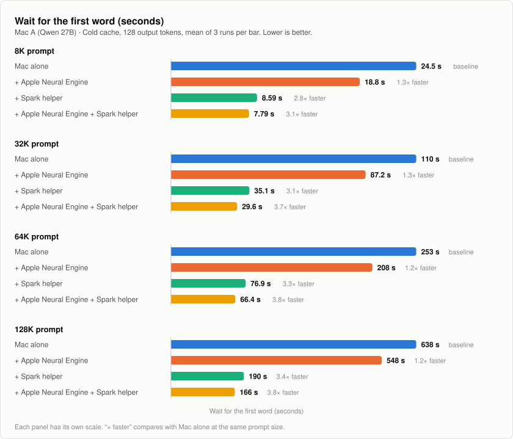
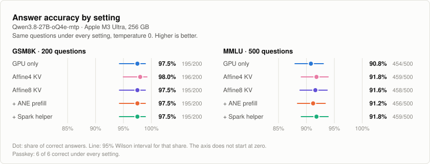
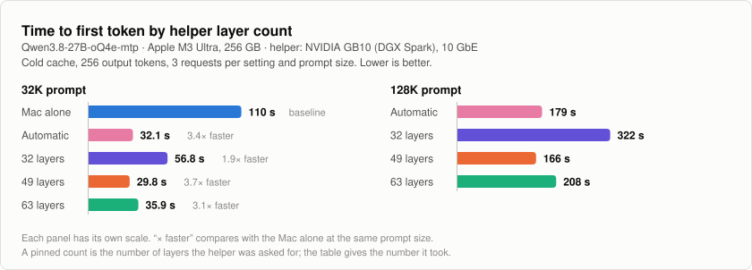
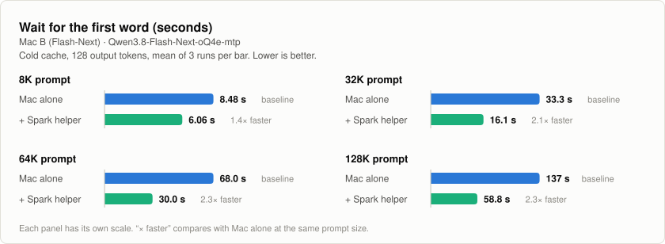
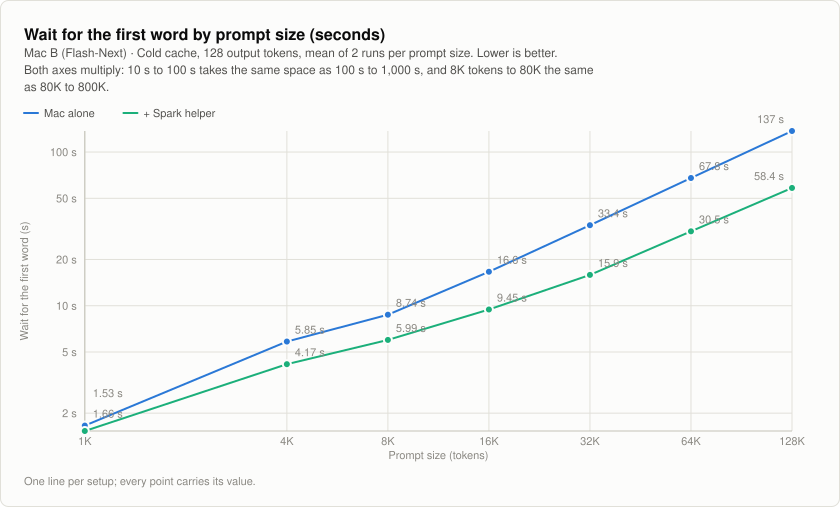
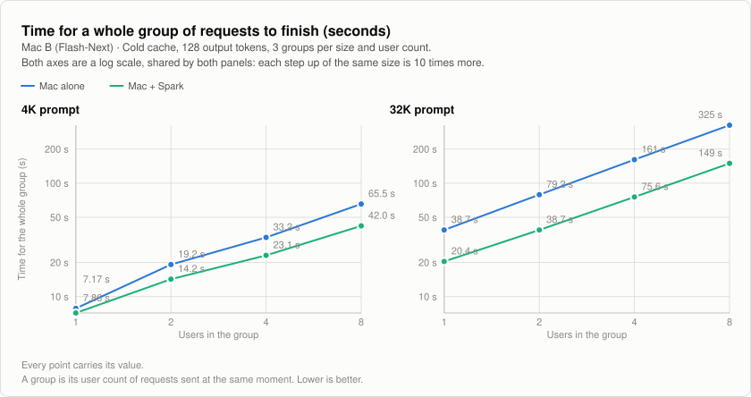
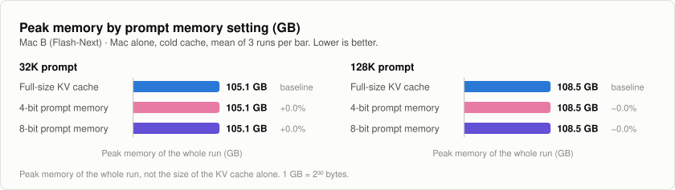

# omlx-fleet-bench

How long does a Mac make you wait for the first token of a long prompt, and what does each
[oMLX](https://github.com/jundot/omlx) add-on buy you?

I measured three things on an Apple M3 Ultra running oMLX, with an NVIDIA DGX Spark as a prefill
helper:

1. **Time to first token** at 8K to 128K prompt tokens, with ANE prefill, with the Spark helper, and
   with both.
2. **KV cache schemes** (native, Affine4, Affine8): what they do to memory and speed.
3. **Answer quality**: whether any of those settings changes what the model answers.

This repository holds the harness, every raw row, and one script that rebuilds every table and chart
below from those rows. It is two Macs, each with a DGX Spark helper, and one model on each. It is not
a leaderboard, and it is not an official oMLX result.

## The answer in one picture

<!-- BEGIN GENERATED: headline -->
<picture>
  <source media="(prefers-color-scheme: dark)" srcset="charts/headline-dark.svg">
  
</picture>

#### Mac A (Qwen 27B)

| Prompt size | Mac alone | Mac + Spark | Faster by |
|---|---:|---:|---:|
| 8K | 24.5 s | 8.6 s | 2.8× |
| 32K | 109.8 s | 35.1 s | 3.1× |
| 64K | 252.8 s (4.2 min) | 76.9 s | 3.3× |
| 128K | 638.1 s (10.6 min) | 189.8 s (3.2 min) | 3.4× |

#### Mac B (Flash-Next)

| Prompt size | Mac alone | Mac + Spark | Faster by |
|---|---:|---:|---:|
| 8K | 8.5 s | 6.1 s | 1.4× |
| 32K | 33.3 s | 16.1 s | 2.1× |
| 64K | 68.0 s | 30.0 s | 2.3× |
| 128K | 137.2 s (2.3 min) | 58.8 s | 2.3× |

- Mac alone is the Mac on its own; Mac + Spark is the same Mac with the Spark helper reading the prompt at the same time.
- Every figure is the mean of the valid runs of that Mac's speed study, each run with a cold cache (the server held none of the prompt).
<!-- END GENERATED: headline -->

## The pages

- [Speed: how long the Mac makes you wait](docs/speed.md)
- [Many people sending prompts at once](docs/many-users.md)
- [Memory: what the KV cache costs](docs/memory.md)
- [Answer quality: does the helper change the answers?](docs/answer-quality.md)
- [Helper start-up and how many layers it holds](docs/helper-setup.md)

## Short version

The first four bullets are the 27B machine; the last one is the Flash-Next machine.

- The Spark helper cuts the wait for the first token 2.8× to 3.4×. At 128K tokens the wait falls
  from 638 s to 190 s.
- ANE prefill alone gives 1.2× to 1.3×, and it stacks with the helper: both together give 3.1× to
  3.8×.
- Affine4 KV cuts peak memory by 24.6% at 128K tokens and costs no speed.
- None of the settings moved accuracy on 700 questions by more than the questions can resolve. Read
  [what the quality test can and cannot tell you](#what-the-quality-test-can-and-cannot-tell-you)
  before you quote that.
- The Flash-Next model has no ANE prefill. On that machine the helper cuts the wait 1.4× at 8K and
  2.3× at 128K, KV cache schemes changed nothing measurable, and no setting changed a single answer
  of 700.

## Time to first token

<picture>
  <source media="(prefers-color-scheme: dark)" srcset="charts/m3-ultra-a-ttft-dark.svg">
  
</picture>

How to read it:

- Each cell is the mean of 3 valid runs with a cold cache (0 cached tokens) and 128 output tokens.
- The two helper cells with a wide spread (8K and 32K) have a cause. The helper is slower when it
  starts after several minutes of Mac-only work, and faster when helper runs come back to back. I ran
  those two cells again back to back; the last line above gives both figures. Treat the first-pass
  numbers in the table as the cold lower bound.
- At 128K the helper read the whole prompt with no drop and no restart. That needed a memory fix in
  the CUDA helper; see [test setup](#test-setup).

## KV cache schemes

<picture>
  <source media="(prefers-color-scheme: dark)" srcset="charts/m3-ultra-a-kv-memory-dark.svg">
  
</picture>

How to read it:

- GPU only: ANE prefill and the helper are off, so the KV scheme is the only thing that changes.
- Memory is the point. Speed barely moves, and it moves the right way.
- Affine4 beats Affine8 on memory at both sizes and equals it on speed.
- On this model both schemes convert 16 of the 64 cache layers (recorded in each row under
  `log.kv_lines`).
- The memory figure is peak MLX active memory for the whole run, in binary gigabytes (2³⁰ bytes).
  The harness does not measure the size of the KV cache alone, and I claim no KV size anywhere.

## Answer quality

<picture>
  <source media="(prefers-color-scheme: dark)" srcset="charts/m3-ultra-a-quality-dark.svg">
  
</picture>

Same questions under every setting: 200 from GSM8K, 500 from MMLU (25 from each of 20 subjects), and
6 passkey prompts (a 7-digit number planted halfway into 32K, 64K and 128K tokens of filler).
3,530 requests, 0 errors.

### What the quality test can and cannot tell you

- **Affine4 and Affine8 are really tested.** KV compression acts on every request, so all 700
  questions exercise it. Neither scheme lowered accuracy.
- **ANE prefill and the Spark helper are tested only by the 6 passkey prompts.** The GSM8K and MMLU
  prompts are about 150 tokens. ANE prefill works in 2,048-token tiles, and on these prompts both
  add-ons show the same time to first token and prefill speed as GPU only. So I read those two rows
  as "the add-on did no work here", not as "the add-on is safe on short prompts". I did not confirm
  this from the server log.
- **Those two rows still give something useful: the noise floor.** With an add-on that did no work
  and temperature 0, 10 and 11 of 700 answers still flipped between right and wrong against GPU
  only (lost plus gained in the table). A change of that size between two settings is run-to-run
  variation, not an effect. Affine8 sits inside it; Affine4 flipped about twice as many answers, in
  both directions.
- **The interval is wide.** With 200 and 500 questions the 95% interval is about ±2 to ±3 points
  (the lines in the chart). A setting that costs one point of accuracy would not show here.
- **The subsets are not the full tests.** The 20-subject MMLU subset is easier than the full test
  set. Compare settings inside this table, not against published scores.
- **Some answers were cut off.** 304 answers ran out of tokens while the model was still thinking
  (caps 1,024 for MMLU and 2,048 for GSM8K). I asked those again with caps 8 times larger. The ones
  in the last column were still cut off, and they count as wrong.
- **The passkey rows come from a cold run.** The first passkey rows were not fully cold: inside one
  setting, a later passkey prompt reused 14,336 or 30,720 cached tokens of the shared filler from the
  prompt before it. The planted number was always in the part that was read fresh, and the cache
  never crossed from one setting to another. The harness now puts a unique line at the start of every
  passkey prompt, so a new run reads the whole prompt. I ran the 30 passkey prompts again on
  2026-11-17 with that fixed harness. Every row has 0 cached tokens and all 30 answers are correct.
  The published passkey numbers come from that run.
- **The first helper request at 32K was slow, and now it has a proven cause.** In that cold passkey
  run the first helper request at 32K took 109.7 s and the next one 30.9 s. After a switch from
  helper off to helper on the server loads the model again and sets up the helper session again. On
  the chat path a request that begins before that session is ready is served by the Mac alone, with
  no error and no warning. The harness now probes the model, waits until the helper state is `ready`
  and stays so, and records the helper state in each row. The replay under
  [helper start](#what-the-first-helper-request-waits) shows the fault 6 times of 6 on the chat
  path; the server's speed-test path did not show it.

## Helper start and layer count

Two more tests on the 27B machine. The first replays the fault that made the first helper request
slow, on the chat path and on the server's own speed-test call. The second sets how much of the
model the helper holds.

### What the first helper request waits

How to read it:

- One round is a request with the helper off, then a request at 32K with the helper on, so every
  helper request starts straight after a switch.
- "No wait" is the old harness behaviour, kept to replay the fault. "Wait" is what the harness does
  now: it probes the model, then waits until the helper reads `ready` and holds it.
- A request counts as running at helper speed when it waited under half of the Mac-alone wait at
  the same prompt size. A request that goes out before the helper session is ready may read the
  whole prompt on the Mac alone and take that full wait: on the chat path all six did, and those
  are the 109.7 s rows above.
- The server's speed-test path did not show the fault. Its no-wait requests began while the helper
  was `starting` and still came back at helper speed. The table shows those six rows, marked not
  valid by `helper_ready_at_start`; no other study uses them.
- The chat rows record no validity block. Every helper-on request in both chat arms read 0 cached
  tokens and answered correctly.

### How many layers the helper holds

<picture>
  <source media="(prefers-color-scheme: dark)" srcset="charts/m3-ultra-a-helper-layers-dark.svg">
  
</picture>

How to read it:

- 49 layers is the fastest setting at both sizes: 29.8 s at 32K and 166.0 s at 128K, means of 3.
  Fewer layers (32) or more (63) are slower at both sizes.
- The automatic choice picks 49 layers, and once 50. At 32K it beat every 49-layer request on its
  best pass and was slower than every one of them on the other two, so it is not as steady; these
  rows do not say why.
- So the automatic default is a fair choice; pinning 49 layers buys the steadiest result, and
  pinning 32 or 63 costs time.
- One model on one machine pair, 3 requests per cell: enough to rank these five settings, not
  enough to separate two of them that differ by a few percent.
- The layer count in the table is what the helper really held, read after the request, and every
  one of these rows records the helper's last prompt, so the helper served all 24. The count it was
  asked for is in `desired_settings` in each row.

## Second machine (Flash-Next)

A second Apple M3 Ultra, 256 GB, with the same model of helper (NVIDIA GB10, DGX Spark, 10 GbE),
ran the same three studies on `Qwen3.8-Flash-Next-oQ4e-mtp`, a mixture-of-experts model, instead of
the 27B dense model. Two things differ from the first machine.

- **No ANE prefill.** ANE prefill is not available for this model on this server build, so I did not
  run it: speed has two settings instead of four, and quality has no ANE setting.
- **The Mac alone is much faster.** The helper still cuts the wait, but by less than it did on the
  27B.

### Time to first token (Flash-Next)

<picture>
  <source media="(prefers-color-scheme: dark)" srcset="charts/m3-ultra-b-ttft-dark.svg">
  
</picture>

How to read it:

- Two setups, not four: GPU only, and the same Mac with the Spark helper.
- Each cell is the mean of 3 valid runs with a cold cache (0 cached tokens) and 128 output tokens.
  All 24 runs completed and every one read its whole prompt.
- The helper is worth 1.4× at 8K, 2.1× at 32K, and 2.3× at 64K and 128K. On the 27B machine the same
  helper gave 2.8× to 3.4×, because that model is slower on the Mac alone.

### Prompt-size sweep (Flash-Next)

<picture>
  <source media="(prefers-color-scheme: dark)" srcset="charts/m3-ultra-b-ttft-sweep-dark.svg">
  
</picture>

How to read it:

- Seven prompt sizes from 1K to 128K, so the wait can be read as a curve rather than four
  points. The four sizes the speed table above also has agree with it to within 3.1%: the
  largest gap is at 8K on the Mac alone. Guard the two against each other with that in mind,
  not as one series: these rows were measured one day earlier, on 2026-11-15, with a second
  DGX Spark unit of the same type as the helper, 2 runs per cell.
- On a log scale a straight line means the wait grows in step with the prompt. From 8K to
  128K the Mac-alone line is near straight: 8.7 s, 16.6 s, 33.4 s, 67.8 s, 137.1 s, close to
  a doubling for each doubling of the prompt. The helper line doubles too from 32K up. The
  helper's share therefore grows with the prompt, 1.1× at 1K, 1.5× at 8K, 2.1× at 32K and
  2.3× at 128K: the Mac alone keeps its prefill speed as the prompt grows, and the helper's
  rises.
- Four rows are kept but marked not valid, and none of them is in a mean. In the sweep file
  one 128K helper run never engaged the helper, so it read as Mac-alone speed. In the rerun
  file, two rows are server conflicts (HTTP 409) from the first attempt, and one is a failed
  run before the valid rerun, made while the helper program had stopped. The last row of that
  file is the 128K helper run the sweep lacked, so every cell has 2 valid runs.

### Many users at once (Flash-Next)

<picture>
  <source media="(prefers-color-scheme: dark)" srcset="charts/m3-ultra-b-many-users-dark.svg">
  
</picture>

How to read it:

- One wave is a number of users who send a prompt of the same size at the same moment, and every
  user of a wave sends the same prompt size. The wave is over when its last reply arrives, so the
  wave time is what the slowest of them waited.
- More users make the wave longer in both arms. On the Mac alone the wave time roughly doubles each
  time the user count doubles; with the helper it also rises at every step.
- At the same cell the whole wave is shorter with the helper than on the Mac alone, at both prompt
  sizes and at every user count. The gap is wider at 32K than at 4K. The speed-up grows with the
  number of users at both prompt sizes: at 4K from 1.10× with one user to 1.56× with eight, and at
  32K from 1.90× to 2.17×.
- The prompt tokens per second column counts every user's prompt together over the wave. Put
  together that way, the wave moves 433 to 846 prompt tokens a second on the Mac alone, and 578 to
  1,751 with the helper. These rows do not say how the server or the helper shares the work between
  users; that was not measured, so the table reads out what happened and not why.
- Limits: one model, one machine pair, 3 waves per cell, 128 output tokens, a cold cache in every
  request. The second user, fourth user and eighth user send at the same instant as the first, so
  this is a burst, not people typing at their own pace.
- These rows were made on 2026-11-18 with the DGX Spark helper that was paired with this Mac that
  day. The sweep above used a second Spark unit of the same type, so read the two as separate
  series, as it says there.

### KV cache schemes (Flash-Next)

<picture>
  <source media="(prefers-color-scheme: dark)" srcset="charts/m3-ultra-b-kv-memory-dark.svg">
  
</picture>

How to read it:

- GPU only, as in the first machine's table: ANE prefill and the helper are off.
- Neither scheme moved anything I can measure on this model. Peak memory stayed at 105.1 GB (32K)
  and 108.5 GB (128K) to the tenth of a gigabyte, and the wait moved by less than half a percent.
- Nothing converted these rows. `log.kv_lines` is empty in all 18 rows, while the 27B rows record two
  conversion lines each. The scheme was asked for in `desired_settings` and the server took it. From
  these rows I cannot tell whether this model does not take the conversion or the server log does not
  report it. I claim no KV cache size either way.

### Answer quality (Flash-Next)

<picture>
  <source media="(prefers-color-scheme: dark)" srcset="charts/m3-ultra-b-quality-dark.svg">
  
</picture>

Same questions under all four settings: 200 from GSM8K, 500 from MMLU and the same 6 passkey prompts.
2,824 requests, 0 errors.

How to read it:

- The four settings answered all 700 questions the same way: 0 lost and 0 gained against GPU only.
  On the 27B machine the add-ons flipped 10 or 11 answers of 700. Nothing moved here at all, so the
  honest reading is "no setting changed an answer on this run", not a measured safety margin.
- 57 answers per setting ran out of tokens while the model was still thinking (caps 1,024 for MMLU,
  2,048 for GSM8K) and count as wrong. I did not re-ask them on this machine, so read the MMLU figure
  as a floor.
- The passkey rows are from a second pass, run with a unique first line in every prompt so each one
  was read cold: 0 cached tokens in all 24 rows. They replace the first-pass rows with the same
  setting, task and sample id, and both passes scored 6 of 6.
- The Spark helper row is tested only by the 6 passkey prompts, for the reason given for the first
  machine: the GSM8K and MMLU prompts are about 150 tokens, too short for a helper to do work on.

## What these numbers do not show

- Two Macs, each with one helper, and one model on each, on a pre-release oMLX build. I do not know
  how far they transfer.
- Cold cache. Every study but one sends one request at a time; the many-users study sends up to 8
  requests at once, and it is the only concurrent result here. There is no warm-cache study: the
  only warm rows are the two noisy helper cells (8K, 32K) run again back to back, straight after
  the matrix, in `results/m3-ultra-a/speed-helper-warm-2026-11-15.jsonl`, as
  [results/README.md](results/README.md) records.
- Three runs per cell. Enough to see a 3× effect, not enough to rank two setups that are 2% apart.
- Decode speed (tokens per second after the first token) is in the raw rows but not studied.
- The server refused a 256K prompt on the Flash-Next model with HTTP 400, so there is no
  256K result: the sweep stops at 128K.
- The helper ran with a memory fix that is not in a release yet. On the stock helper the same 128K
  run failed.

## Test setup

| | |
|---|---|
| Mac | Apple M3 Ultra, 60-core GPU, 256 GB, macOS 27.2.1 |
| Server | oMLX 0.8.0rc1 |
| Model | `Jundot/Qwen3.8-27B-oQ4e-mtp`, 4-bit MLX, 16 GB on disk |
| Helper | NVIDIA GB10 (DGX Spark, 128 GB) on a 10 GbE link |
| Helper software | oMLX CUDA helper 0.1.4 plus the long-prompt memory fix proposed in [jundot/omlx#5271](https://github.com/jundot/omlx/pull/5271) |
| Speed prompts | 8K, 32K, 64K, 128K tokens, `code_python` profile, 128 output tokens, cold cache |
| Dates | Speed and KV cache 2026-11-15, quality 2026-11-16 plus a passkey rerun 2026-11-17 |
| Second machine | Apple M3 Ultra, 256 GB, same DGX Spark helper, model `Qwen3.8-Flash-Next-oQ4e-mtp`; speed and KV cache 2026-11-16, speed sweep 2026-11-15, quality 2026-11-16 plus a passkey rerun 2026-11-17 |

The method, the rules that decide whether a row counts, and the known limits are in
[docs/method.md](docs/method.md).

## Run it yourself

Python 3.9 or newer. Standard library only; there is nothing to install.

Speed (time to first token and prefill speed):

```bash
python3 bench/run.py \
  --matrix matrices/m3-ultra-spark.json \
  --base-url http://127.0.0.1:8004 \
  --settings "$HOME/.omlx/settings.json" \
  --server-log "$HOME/.omlx/logs/server.log" \
  --helper-node YOUR_HELPER_NODE_ID \
  --machine your-label \
  --out results/your-label/speed-DATE.jsonl

python3 bench/report.py results/your-label/speed-DATE.jsonl --report-dir report
```

Answer quality (about 85 minutes per setting on the hardware above, so about 7 hours for all five):

```bash
python3 bench/quality.py \
  --matrix matrices/quality.json \
  --base-url http://127.0.0.1:8004 \
  --settings "$HOME/.omlx/settings.json" \
  --helper-node YOUR_HELPER_NODE_ID \
  --machine your-label \
  --out results/your-label/quality-DATE.jsonl

python3 bench/quality_report.py results/your-label/quality-DATE.jsonl --out report/quality.md
```

Many users at once (one wave is N requests that begin at the same moment):

```bash
python3 bench/concurrency.py \
  --matrix matrices/m3-ultra-b-many-users.json \
  --base-url http://127.0.0.1:8004 \
  --settings "$HOME/.omlx/settings.json" \
  --helper-node YOUR_HELPER_NODE_ID \
  --machine your-label \
  --out results/your-label/many-users-DATE.jsonl
```

I ran `bench/report.py` on a many-users file and it wrote a speed summary with an empty table: it
groups speed rows only. The wave tables and charts come from `python3 bench/publish.py`, which reads
the file listed under `many_users` for your machine in `results/published.json`.

Useful options: `--dry-run` prints the plan and touches nothing. `--only-cells gpu:32768` (speed) and
`--only-variants`, `--only-tasks`, `--limit N` (quality) narrow a run; `--users 1,2,4` and `--waves 3`
(many users) override the user counts and the wave count in the matrix. `--retry-capped FILE
--max-tokens-scale 8` asks the cut-off answers in `FILE` again with a larger cap, and
`quality_report.py --replace` merges them in.

What the harness does to your server:

- **Runs stay private.** Every speed run is started with `align_prompt_to_ane` on, so the server
  ends it with `upload_skipped`. Nothing goes to the public omlx.ai leaderboard, and the harness
  refuses to start a run with that flag off. The quality path uses plain chat requests, which have
  no upload at all.
- **Settings are put back.** The harness saves the model settings it touches, changes only those,
  and restores them in a `finally` block. After each study I compared the settings file with a copy
  taken before it; they were identical.
- **The API key is never printed.** It is read from `settings.json` and used for a session cookie.

## Check my numbers

```bash
python3 -m unittest discover -s tests
python3 bench/publish.py --check
```

The first command runs the unit tests. The second recomputes every table and chart in this README
from the raw rows in `results/` and fails if a single byte differs from what is committed.
`python3 bench/publish.py` without `--check` writes them again. `results/published.json` lists which
raw files make up each study.

## Add your machine

Results from other Macs, other helpers and other models are welcome. The short form: run a matrix
with your own `--machine` label, keep the JSONL untouched, and open a pull request.
[CONTRIBUTING.md](CONTRIBUTING.md) has the steps and what to redact.

## Repository map

| Path | What is in it |
|---|---|
| [bench/run.py](bench/run.py) | Speed runner: one JSONL row per benchmark run |
| [bench/quality.py](bench/quality.py) | Answer-quality runner: one JSONL row per question |
| [bench/concurrency.py](bench/concurrency.py) | Many-users runner: one JSONL row per request of a wave |
| [bench/chatrows.py](bench/chatrows.py) | The chat row both chat runners write, and the rule that stops a run |
| [bench/report.py](bench/report.py), [bench/quality_report.py](bench/quality_report.py) | Summaries of your own rows |
| [bench/latency.py](bench/latency.py) | Reads a speed row or a chat row as one request: its wait, its setting, its helper state |
| [bench/waves.py](bench/waves.py) | Reads the requests of a many-users study as waves, cell by cell |
| [bench/publish.py](bench/publish.py) | Rebuilds the README tables, `reports/` and `charts/` from `results/` |
| [bench/charts.py](bench/charts.py), [bench/svg.py](bench/svg.py) | The chart forms and the SVG writer behind them |
| [bench/stats.py](bench/stats.py) | The small statistics helpers the reports and charts share |
| [bench/labels.py](bench/labels.py) | Variant display names, order and chart colour, in one place |
| [bench/client.py](bench/client.py), [bench/chat.py](bench/chat.py) | oMLX admin API and chat API clients |
| [bench/validity.py](bench/validity.py) | Decides whether a speed row counts |
| [bench/helper.py](bench/helper.py) | Helper session field names, the read, and the wait rule |
| [bench/runflow.py](bench/runflow.py) | The order of calls around a measured request, shared by both runners |
| [bench/collect.py](bench/collect.py) | Parses the benchmark sections of the oMLX server log |
| [bench/qa.py](bench/qa.py) | Quality tasks: passkey, GSM8K and MMLU prompts and scoring, no network |
| [bench/matrix.py](bench/matrix.py) | Loads a matrix and expands its cells in A/B run order |
| [bench/__init__.py](bench/__init__.py) | Marks `bench/` as a Python package |
| [matrices/](matrices) | What to run: variants, prompt sizes, tasks |
| [data/](data) | The fixed GSM8K and MMLU subsets, and how they were built |
| [results/](results) | Raw rows, one JSONL file per run, and the field reference |
| [reports/](reports) | Generated per-cell summaries |
| [charts/](charts) | Generated charts, light and dark |
| [docs/method.md](docs/method.md) | Method, validity rules, limits |
| [scripts/fetch_quality_data.py](scripts/fetch_quality_data.py) | Builds the fixed GSM8K and MMLU files in `data/` |
| [tests/](tests) | Unit tests for the harness, with their fixtures |
| [.github/workflows/tests.yml](.github/workflows/tests.yml) | Runs the unit tests and the publish check on a push |

`matrices/m3-ultra-b-speed.json`, `m3-ultra-b-kv-cache.json` and `m3-ultra-b-quality.json` are the
three matrices behind the Flash-Next tables. `m3-ultra-b-speed-sweep.json` and `m3-ultra-b-256k.json`
are behind the prompt-size sweep. `matrices/m3-ultra-a-helper-ready.json` and
`m3-ultra-a-helper-ready-chat.json` are behind the helper-start table, and
`m3-ultra-a-helper-layers-chat-32k.json` and `m3-ultra-a-helper-layers-chat-128k.json` behind the
layer table. `matrices/flash-next-moe.json` is an earlier matrix for
a mixture-of-experts model; its results are not published here.

## Credits and scope

oMLX is the work of its authors; this repository only measures it. GSM8K and MMLU belong to their
authors and are used under the MIT license (see [data/README.md](data/README.md)). NVIDIA, DGX Spark,
Apple and other product names are trademarks of their owners. This is an independent Gumbii Digital
engineering record, and no endorsement by any of them is implied.

## License

Apache License 2.0. See [LICENSE](LICENSE).
