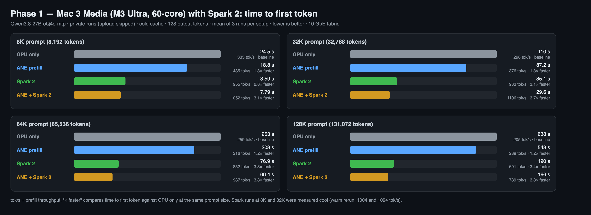
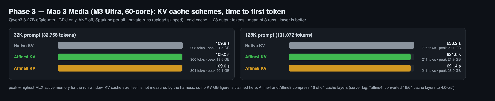
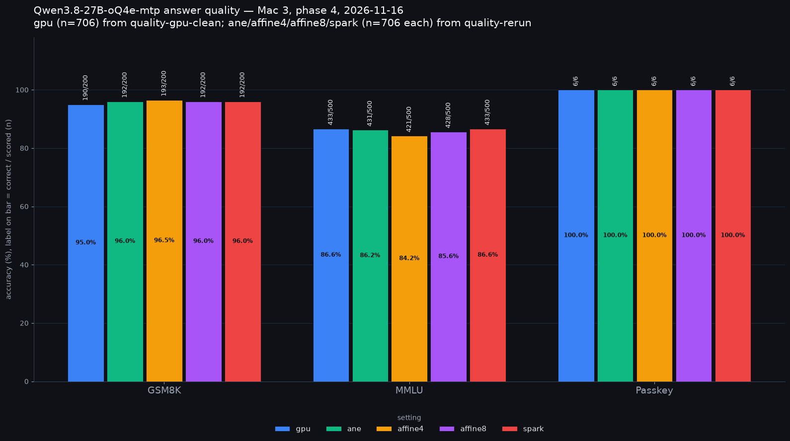

# omlx-fleet-bench

Repeatable, private throughput benchmarks for oMLX: how long do you wait for the first token, on your Mac,
and what does each add-on buy you? Fixed matrices, 3 runs per cell, raw rows in the repo.

Every run is private: the harness always sends `align_prompt_to_ane: true`, so the prompt is ANE-aligned
and each run ends with `upload_skipped`. Nothing here is uploaded to the public omlx.ai leaderboard, and
the harness refuses to start a run with that flag off.

## Results

Apple M3 Ultra, 60-core GPU, 256 GB, macOS 27.2.1, oMLX 0.8.0rc1, model `Jundot/Qwen3.8-27B-oQ4e-mtp`
(4-bit MLX, 16 GB on disk). Helper: NVIDIA GB10 (DGX Spark, 128 GB) over a 10 GbE link, CUDA helper 0.1.4
with a local fix for long-prompt memory (the same runs failed at 128K on the stock helper).
Prompts: 8K, 32K, 64K, 128K tokens, `code_python` profile, 128 output tokens, cold cache.
Each cell is the mean of 3 runs; spread is under 1% except where noted.

Prefill speed and time to first token (lower is better):

| Setup | 8K | 32K | 64K | 128K |
|---|---:|---:|---:|---:|
| GPU only | 335 tok/s · 24.5 s | 298 tok/s · 109.8 s | 259 tok/s · 252.8 s | 205 tok/s · 638.1 s |
| + ANE prefill | 435 tok/s · 18.8 s | 376 tok/s · 87.2 s | 316 tok/s · 207.5 s | 239 tok/s · 548.3 s |
| + Spark helper | 955 tok/s · 8.6 s | 933 tok/s · 35.1 s | 852 tok/s · 76.9 s | 691 tok/s · 189.8 s |
| + ANE + Spark | 1052 tok/s · 7.8 s | 1106 tok/s · 29.6 s | 987 tok/s · 66.4 s | 789 tok/s · 166.1 s |



Reading the numbers:

- The Spark helper cuts the wait 2.8x (8K) to 3.4x (128K). Time to first token at 128K falls 638 s to 190 s.
- ANE prefill alone gives 1.2x to 1.3x. It is cheap to turn on, and it stacks with the helper.
- ANE + Spark is fastest everywhere: 3.1x to 3.8x.
- At 128K the helper ran the whole prompt with no drop and no restart (peak 27.6 GB of MLX active memory).
- Noise: the 8K and 32K helper cells came out at 7.5% and 4.3% spread. Helper throughput rises about 5%
  (8K) and 15% (32K) when the helper runs back to back instead of behind several minutes of Mac-only work.
  Those two cells were re-measured once (rows 49-54 in the raw file) and the warm numbers are 1004 and
  1094 tok/s. Treat the first-pass helper numbers as a cold lower bound.

## KV cache schemes

GPU only, ANE off, helper off. Same model, 32K and 128K, 3 runs per cell, 0.07% maximum spread.

| Scheme | 32K: prefill · TTFT · peak memory | 128K: prefill · TTFT · peak memory |
|---|---|---|
| Native | 298.3 tok/s · 109.9 s · 21.5 GB | 205.4 tok/s · 638.2 s · 29.1 GB |
| Affine4 | 300.5 tok/s · 109.0 s · 19.6 GB | 211.1 tok/s · 621.0 s · 21.9 GB |
| Affine8 | 300.6 tok/s · 109.0 s · 20.1 GB | 210.9 tok/s · 621.4 s · 23.9 GB |



- Speed barely moves: +0.7% prefill at 32K, +2.8% at 128K.
- Memory is the point: peak MLX active memory falls 29.1 GB to 21.9 GB at 128K (-24.6%).
- Affine4 is better than Affine8 at both sizes on memory, and equal on speed.
- Affine4 and Affine8 compress 16 of 64 cache layers (server log: `affine4: converted 16/64 cache layers to 4.0-bit`).
- KV cache size in GB is **not** measured by this harness. The peak memory figure above is MLX active
  memory for the run window, not the KV cache alone. No KV size is claimed anywhere in this repo.

## Answer quality (phase 4)

Does a setting change what the model answers? `bench/quality.py` asks the same questions under each
setting and `bench/quality_report.py` gives accuracy per setting and task.

- Tasks: GSM8K (200 questions from the test split), MMLU (500 questions, 25 from each of 20 subjects),
  and passkey retrieval at 32K, 64K and 128K (a 7-digit number planted halfway into a long prompt).
- Data: `data/gsm8k-200.jsonl`, `data/mmlu-500.jsonl`, rebuilt with `scripts/fetch_quality_data.py`.
  Both are subsets of public MIT-licensed sets; the sampling error is about 3 to 4 points (see `data/README.md`).
- Settings: GPU only, + ANE prefill, Affine4 KV, Affine8 KV, + Spark helper. 3,530 requests.
- Nothing is uploaded: the chat path has no leaderboard upload.

### Result (Mac 3 + Spark 2, Qwen3.8-27B-oQ4e-mtp, 2026-11-16)

No setting changes answer quality by more than the sampling error. 3,530 requests, 0 errors,
settings put back unchanged after the run.



| Setting | GSM8K (of 200) | MMLU (of 500) | Passkey (of 6) |
| --- | ---: | ---: | ---: |
| GPU only | 190 (95.0%) | 433 (86.6%) | 6 |
| + ANE prefill | 192 (96.0%) | 431 (86.2%) | 6 |
| Affine4 KV | 193 (96.5%) | 421 (84.2%) | 6 |
| Affine8 KV | 192 (96.0%) | 428 (85.6%) | 6 |
| + Spark helper | 192 (96.0%) | 433 (86.6%) | 6 |

- Affine4 is lowest on MMLU, by 2.4 points: inside the 3 to 4 point sampling error, so not a proven loss.
- 302 of 3,530 answers (56 to 70 per setting) hit the token cap (1,024 or 2,048) while the model was
  still thinking, so they have no final answer and count as wrong. The cap is the same for every
  setting, so the comparison holds; the absolute scores are a little low.
- Raw rows: `results/mac3-media/quality-gpu-clean-2026-11-16.jsonl` (GPU block) and
  `results/mac3-media/quality-rerun-2026-11-16.jsonl` (the other four). Summary: `report-phase4/summary.md`.
- The first full run stopped after the GPU block: the server answered HTTP 409 "unload pending" after a
  settings change. The runner now retries 409, waits for the model to answer after each settings change
  (`--ready-timeout`), and stops after repeated identical failures (`--max-consecutive-failures`).

```bash
python3 bench/quality.py --matrix matrices/quality.json \
  --base-url http://127.0.0.1:8004 \
  --settings "$HOME/.omlx/settings.json" \
  --helper-node YOUR_HELPER_NODE_ID \
  --machine your-label \
  --out results/your-label/quality-2026-11-16.jsonl

python3 bench/quality_report.py results/your-label/quality-2026-11-16.jsonl --out report/quality.md
```

`--limit N` runs the first N samples of each task, `--only-variants` and `--only-tasks` narrow the
matrix, and `--dry-run` prints the plan. Measured on the hardware below, one setting takes about 85
minutes, so the whole matrix is roughly 7 hours.

## How to run

```bash
python3 bench/run.py \
  --matrix matrices/m3-ultra-spark.json \
  --base-url http://127.0.0.1:8004 \
  --settings "$HOME/.omlx/settings.json" \
  --server-log "$HOME/.omlx/logs/server.log" \
  --helper-node YOUR_HELPER_NODE_ID \
  --machine your-label \
  --out results/your-label/2026-11-15.jsonl
```

Add `--dry-run` to print the planned order without touching the server. Filter cells with
`--only-cells gpu:32768,ane:32768`. The harness reads the API key from `settings.json` (`auth.api_key`),
keeps a session cookie, and never prints the key. It snapshots the model settings it touches and puts them
back in a `finally` block; proof that it worked is a byte-identical `settings.json` afterwards.

Report:

```bash
python3 bench/report.py results --report-dir report
# report/summary.md plus report/charts/*.svg
# exit 0 only when every cell has its planned valid runs and no cell is noisy (>3% spread)
```

Note: `report.py` groups by machine, model, variant and size, so it merges every JSONL under the results
folder it is given. To report one phase, give it a folder that holds only that phase's file.

## Layout

- `bench/client.py` — admin API login, settings snapshot/restore, bench start, poll, event stream
- `bench/matrix.py` — matrix JSON to ordered run list
- `bench/run.py` — runs the cells, appends one JSONL row per run
- `bench/collect.py` — parses `[benchmark-pp-result]` lines from `server.log`
- `bench/validity.py` — decides whether a row counts (flags, cached tokens, status, ANE tiles)
- `bench/report.py` — summary table and SVG charts
- `matrices/` — the matrices used here (`m3-ultra-spark.json`, `kv-cache.json`, plus `smoke.json`)
- `results/<machine>/` — raw rows, one JSONL per phase
- `report-phase1/`, `report-phase3/`, `report-phase4/` — generated summaries (and SVG charts) for the runs above
- `charts/` — the PNG charts in this README
- `docs/method.md` — test matrix, method rules, validity rules, known limits

## Tests

```bash
python3 -m unittest discover -s tests -v
```

Python 3.9 or newer, standard library only.

## Adding your machine

1. Run a matrix with `--machine your-label` and `--out results/your-label/DATE.jsonl`.
2. Keep the JSONL, and say which matrix, model, oMLX version and hardware you used.
3. Open a pull request with your rows.

## License

Apache License 2.0, see `LICENSE`.
