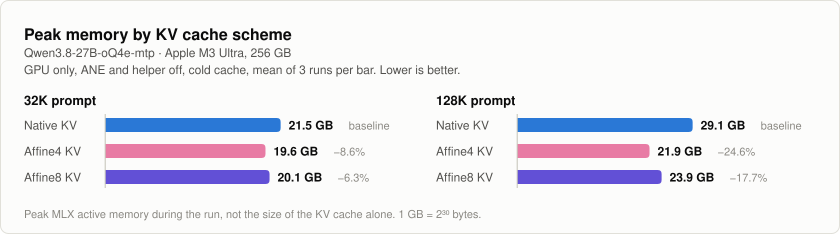
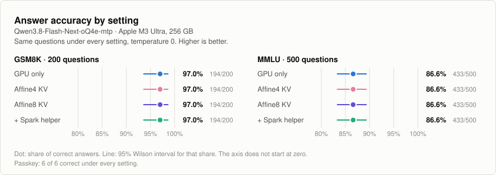

# omlx-fleet-bench

How long does a Mac make you wait for the first token of a long prompt, and what does each
[oMLX](https://github.com/jundot/omlx) add-on buy you?

I measured three things on an Apple M3 Ultra running oMLX, with an NVIDIA DGX Spark as a prefill
helper:

1. **Time to first token** at 8K to 128K prompt tokens, with ANE prefill, with the Spark helper, and
   with both.
2. **KV cache schemes** (native, Affine4, Affine8): what they do to memory and speed.
3. **Answer quality**: whether any of those settings changes what the model answers.

This repository holds the harness, every raw row, and one script that rebuilds every table and chart
below from those rows. It is two Macs, each with a DGX Spark helper, and one model on each. It is not
a leaderboard, and it is not an official oMLX result.

## Short version

The first four bullets are the 27B machine; the last one is the Flash-Next machine.

- The Spark helper cuts the wait for the first token 2.8× to 3.4×. At 128K tokens the wait falls
  from 638 s to 190 s.
- ANE prefill alone gives 1.2× to 1.3×, and it stacks with the helper: both together give 3.1× to
  3.8×.
- Affine4 KV cuts peak memory by 24.6% at 128K tokens and costs no speed.
- None of the settings moved accuracy on 700 questions by more than the questions can resolve. Read
  [what the quality test can and cannot tell you](#what-the-quality-test-can-and-cannot-tell-you)
  before you quote that.
- The Flash-Next model has no ANE prefill. On that machine the helper cuts the wait 1.4× at 8K and
  2.3× at 128K, KV cache schemes changed nothing measurable, and no setting changed a single answer
  of 700.

## Time to first token

<picture>
  <source media="(prefers-color-scheme: dark)" srcset="charts/m3-ultra-a-ttft-dark.svg">
  
</picture>

<!-- BEGIN GENERATED: speed m3-ultra-a -->
Time to first token, and how many times shorter the wait is than GPU only:

| Setup | 8K | 32K | 64K | 128K |
|---|---:|---:|---:|---:|
| GPU only | 24.5 s | 109.8 s | 252.8 s | 638.1 s |
| + ANE prefill | 18.8 s · 1.3× | 87.2 s · 1.3× | 207.5 s · 1.2× | 548.3 s · 1.2× |
| + Spark helper | 8.6 s · 2.8× | 35.1 s · 3.1× | 76.9 s · 3.3× | 189.8 s · 3.4× |
| + ANE + Spark | 7.8 s · 3.1× | 29.6 s · 3.7× | 66.4 s · 3.8× | 166.1 s · 3.8× |

Prefill speed in tokens per second:

| Setup | 8K | 32K | 64K | 128K |
|---|---:|---:|---:|---:|
| GPU only | 335 | 298 | 259 | 205 |
| + ANE prefill | 435 | 376 | 316 | 239 |
| + Spark helper | 955 | 933 | 852 | 691 |
| + ANE + Spark | 1,052 | 1,106 | 987 | 789 |

Run-to-run spread of prefill speed is at most 2.9% in every cell except + Spark helper at 8K (7.5%), + Spark helper at 32K (4.3%).
Re-run back to back, 3 runs each: + Spark helper at 8K: 1,004 tok/s (955 in the first pass), + Spark helper at 32K: 1,094 tok/s (933 in the first pass).
<!-- END GENERATED: speed m3-ultra-a -->

How to read it:

- Each cell is the mean of 3 valid runs with a cold cache (0 cached tokens) and 128 output tokens.
- The two helper cells with a wide spread (8K and 32K) have a cause. The helper is slower when it
  starts after several minutes of Mac-only work, and faster when helper runs come back to back. I ran
  those two cells again back to back; the last line above gives both figures. Treat the first-pass
  numbers in the table as the cold lower bound.
- At 128K the helper read the whole prompt with no drop and no restart. That needed a memory fix in
  the CUDA helper; see [test setup](#test-setup).

## KV cache schemes

<picture>
  <source media="(prefers-color-scheme: dark)" srcset="charts/m3-ultra-a-kv-memory-dark.svg">
  
</picture>

<!-- BEGIN GENERATED: kv-cache m3-ultra-a -->
| Scheme | 32K peak memory | 32K time to first token | 128K peak memory | 128K time to first token |
|---|---:|---:|---:|---:|
| Native KV | 21.5 GB | 109.9 s | 29.1 GB | 638.2 s |
| Affine4 KV | 19.6 GB · −8.6% | 109.0 s · −0.7% | 21.9 GB · −24.6% | 621.0 s · −2.7% |
| Affine8 KV | 20.1 GB · −6.3% | 109.0 s · −0.8% | 23.9 GB · −17.7% | 621.4 s · −2.6% |

Run-to-run spread of prefill speed is at most 0.07% in every cell.
<!-- END GENERATED: kv-cache m3-ultra-a -->

How to read it:

- GPU only: ANE prefill and the helper are off, so the KV scheme is the only thing that changes.
- Memory is the point. Speed barely moves, and it moves the right way.
- Affine4 beats Affine8 on memory at both sizes and equals it on speed.
- On this model both schemes convert 16 of the 64 cache layers (recorded in each row under
  `log.kv_lines`).
- The memory figure is peak MLX active memory for the whole run, in binary gigabytes (2³⁰ bytes).
  The harness does not measure the size of the KV cache alone, and I claim no KV size anywhere.

## Answer quality

<picture>
  <source media="(prefers-color-scheme: dark)" srcset="charts/m3-ultra-a-quality-dark.svg">
  
</picture>

<!-- BEGIN GENERATED: quality m3-ultra-a -->
| Setting | GSM8K (of 200) | MMLU (of 500) | Passkey (of 6) | Answers changed against GPU only | Still cut off |
|---|---:|---:|---:|---:|---:|
| GPU only | 195 · 97.5% | 454 · 90.8% | 6 | baseline | 16 |
| Affine4 KV | 196 · 98.0% | 459 · 91.8% | 6 | 7 lost, 13 gained (of 700) | 17 |
| Affine8 KV | 195 · 97.5% | 458 · 91.6% | 6 | 2 lost, 6 gained (of 700) | 12 |
| + ANE prefill | 195 · 97.5% | 456 · 91.2% | 6 | 4 lost, 6 gained (of 700) | 17 |
| + Spark helper | 195 · 97.5% | 459 · 91.8% | 6 | 3 lost, 8 gained (of 700) | 12 |
<!-- END GENERATED: quality m3-ultra-a -->

Same questions under every setting: 200 from GSM8K, 500 from MMLU (25 from each of 20 subjects), and
6 passkey prompts (a 7-digit number planted halfway into 32K, 64K and 128K tokens of filler).
3,530 requests, 0 errors.

### What the quality test can and cannot tell you

- **Affine4 and Affine8 are really tested.** KV compression acts on every request, so all 700
  questions exercise it. Neither scheme lowered accuracy.
- **ANE prefill and the Spark helper are tested only by the 6 passkey prompts.** The GSM8K and MMLU
  prompts are about 150 tokens. ANE prefill works in 2,048-token tiles, and on these prompts both
  add-ons show the same time to first token and prefill speed as GPU only. So I read those two rows
  as "the add-on did no work here", not as "the add-on is safe on short prompts". I did not confirm
  this from the server log.
- **Those two rows still give something useful: the noise floor.** With an add-on that did no work
  and temperature 0, 10 and 11 of 700 answers still flipped between right and wrong against GPU
  only (lost plus gained in the table). A change of that size between two settings is run-to-run
  variation, not an effect. Affine8 sits inside it; Affine4 flipped about twice as many answers, in
  both directions.
- **The interval is wide.** With 200 and 500 questions the 95% interval is about ±2 to ±3 points
  (the lines in the chart). A setting that costs one point of accuracy would not show here.
- **The subsets are not the full tests.** The 20-subject MMLU subset is easier than the full test
  set. Compare settings inside this table, not against published scores.
- **Some answers were cut off.** 304 answers ran out of tokens while the model was still thinking
  (caps 1,024 for MMLU and 2,048 for GSM8K). I asked those again with caps 8 times larger. The ones
  in the last column were still cut off, and they count as wrong.
- **The passkey prompts were not fully cold.** Inside one setting, a later passkey prompt reused
  14,336 or 30,720 cached tokens of the shared filler from the prompt before it. The planted number
  was always in the part that was read fresh, and the cache never crossed from one setting to
  another. The harness now puts a unique line at the start of every passkey prompt, so a new run
  reads the whole prompt. These rows were recorded before that change.

## Second machine (Flash-Next)

A second Apple M3 Ultra, 256 GB, with the same model of helper (NVIDIA GB10, DGX Spark, 10 GbE),
ran the same three studies on `Qwen3.8-Flash-Next-oQ4e-mtp`, a mixture-of-experts model, instead of
the 27B dense model. Two things differ from the first machine.

- **No ANE prefill.** The server answers HTTP 400 when an ANE prefill is asked for with this model,
  so no table below has an ANE setup and speed has two setups instead of four.
- **The Mac alone is much faster.** The helper still cuts the wait, but by less than it did on the
  27B.

### Time to first token (Flash-Next)

<picture>
  <source media="(prefers-color-scheme: dark)" srcset="charts/m3-ultra-b-ttft-dark.svg">
  
</picture>

<!-- BEGIN GENERATED: speed m3-ultra-b -->
Time to first token, and how many times shorter the wait is than GPU only:

| Setup | 8K | 32K | 64K | 128K |
|---|---:|---:|---:|---:|
| GPU only | 8.5 s | 33.3 s | 68.0 s | 137.2 s |
| + Spark helper | 6.1 s · 1.4× | 16.1 s · 2.1× | 30.0 s · 2.3× | 58.8 s · 2.3× |

Prefill speed in tokens per second:

| Setup | 8K | 32K | 64K | 128K |
|---|---:|---:|---:|---:|
| GPU only | 966 | 983 | 963 | 955 |
| + Spark helper | 1,353 | 2,030 | 2,185 | 2,230 |

Run-to-run spread of prefill speed is at most 2.9% in every cell except + Spark helper at 32K (4.1%).
<!-- END GENERATED: speed m3-ultra-b -->

How to read it:

- Two setups, not four: GPU only, and the same Mac with the Spark helper.
- Each cell is the mean of 3 valid runs with a cold cache (0 cached tokens) and 128 output tokens.
  All 24 runs completed and every one read its whole prompt.
- The helper is worth 1.4× at 8K, 2.1× at 32K, and 2.3× at 64K and 128K. On the 27B machine the same
  helper gave 2.8× to 3.4×, because that model is slower on the Mac alone.

### KV cache schemes (Flash-Next)

<picture>
  <source media="(prefers-color-scheme: dark)" srcset="charts/m3-ultra-b-kv-memory-dark.svg">
  
</picture>

<!-- BEGIN GENERATED: kv-cache m3-ultra-b -->
| Scheme | 32K peak memory | 32K time to first token | 128K peak memory | 128K time to first token |
|---|---:|---:|---:|---:|
| Native KV | 105.1 GB | 33.5 s | 108.5 GB | 137.7 s |
| Affine4 KV | 105.1 GB · +0.0% | 33.6 s · +0.4% | 108.5 GB · −0.0% | 137.6 s · −0.1% |
| Affine8 KV | 105.1 GB · +0.0% | 33.6 s · +0.3% | 108.5 GB · −0.0% | 137.9 s · +0.1% |

Run-to-run spread of prefill speed is at most 1.47% in every cell.
<!-- END GENERATED: kv-cache m3-ultra-b -->

How to read it:

- GPU only, as in the first machine's table: ANE prefill and the helper are off.
- Neither scheme moved anything I can measure on this model. Peak memory stayed at 105.1 GB (32K)
  and 108.5 GB (128K) to the tenth of a gigabyte, and the wait moved by less than half a percent.
- Nothing converted these rows. `log.kv_lines` is empty in all 18 rows, while the 27B rows record two
  conversion lines each. The scheme was asked for in `desired_settings` and the server took it. From
  these rows I cannot tell whether this model does not take the conversion or the server log does not
  report it. I claim no KV cache size either way.

### Answer quality (Flash-Next)

<picture>
  <source media="(prefers-color-scheme: dark)" srcset="charts/m3-ultra-b-quality-dark.svg">
  
</picture>

<!-- BEGIN GENERATED: quality m3-ultra-b -->
| Setting | GSM8K (of 200) | MMLU (of 500) | Passkey (of 6) | Answers changed against GPU only | Still cut off |
|---|---:|---:|---:|---:|---:|
| GPU only | 194 · 97.0% | 433 · 86.6% | 6 | baseline | 57 |
| Affine4 KV | 194 · 97.0% | 433 · 86.6% | 6 | 0 lost, 0 gained (of 700) | 57 |
| Affine8 KV | 194 · 97.0% | 433 · 86.6% | 6 | 0 lost, 0 gained (of 700) | 57 |
| + Spark helper | 194 · 97.0% | 433 · 86.6% | 6 | 0 lost, 0 gained (of 700) | 57 |
<!-- END GENERATED: quality m3-ultra-b -->

Same questions under all four settings: 200 from GSM8K, 500 from MMLU and the same 6 passkey prompts.
2,824 requests, 0 errors.

How to read it:

- The four settings answered all 700 questions the same way: 0 lost and 0 gained against GPU only.
  On the 27B machine the add-ons flipped 10 or 11 answers of 700. Nothing moved here at all, so the
  honest reading is "no setting changed an answer on this run", not a measured safety margin.
- 57 answers per setting ran out of tokens while the model was still thinking (caps 1,024 for MMLU,
  2,048 for GSM8K) and count as wrong. I did not re-ask them on this machine, so read the MMLU figure
  as a floor.
- The passkey rows are from a second pass, run with a unique first line in every prompt so each one
  was read cold: 0 cached tokens in all 24 rows. They replace the first-pass rows with the same
  setting, task and sample id, and both passes scored 6 of 6.
- The Spark helper row is tested only by the 6 passkey prompts, for the reason given for the first
  machine: the GSM8K and MMLU prompts are about 150 tokens, too short for a helper to do work on.

## What these numbers do not show

- Two Macs, each with one helper, and one model on each, on a pre-release oMLX build. I do not know
  how far they transfer.
- Cold cache and one request at a time. No warm-cache numbers and no concurrency.
- Three runs per cell. Enough to see a 3× effect, not enough to rank two setups that are 2% apart.
- Decode speed (tokens per second after the first token) is in the raw rows but not studied.
- The helper ran with a memory fix that is not in a release yet. On the stock helper the same 128K
  run failed.

## Test setup

| | |
|---|---|
| Mac | Apple M3 Ultra, 60-core GPU, 256 GB, macOS 27.2.1 |
| Server | oMLX 0.8.0rc1 |
| Model | `Jundot/Qwen3.8-27B-oQ4e-mtp`, 4-bit MLX, 16 GB on disk |
| Helper | NVIDIA GB10 (DGX Spark, 128 GB) on a 10 GbE link |
| Helper software | oMLX CUDA helper 0.1.4 plus the long-prompt memory fix proposed in [jundot/omlx#5271](https://github.com/jundot/omlx/pull/5271) |
| Speed prompts | 8K, 32K, 64K, 128K tokens, `code_python` profile, 128 output tokens, cold cache |
| Dates | Speed and KV cache 2026-11-15, quality 2026-11-16 |
| Second machine | Apple M3 Ultra, 256 GB, same DGX Spark helper, model `Qwen3.8-Flash-Next-oQ4e-mtp`; speed and KV cache 2026-11-16, quality 2026-11-16 plus a passkey rerun 2026-11-17 |

The method, the rules that decide whether a row counts, and the known limits are in
[docs/method.md](docs/method.md).

## Run it yourself

Python 3.9 or newer. Standard library only; there is nothing to install.

Speed (time to first token and prefill speed):

```bash
python3 bench/run.py \
  --matrix matrices/m3-ultra-spark.json \
  --base-url http://127.0.0.1:8004 \
  --settings "$HOME/.omlx/settings.json" \
  --server-log "$HOME/.omlx/logs/server.log" \
  --helper-node YOUR_HELPER_NODE_ID \
  --machine your-label \
  --out results/your-label/speed-DATE.jsonl

python3 bench/report.py results/your-label/speed-DATE.jsonl --report-dir report
```

Answer quality (about 85 minutes per setting on the hardware above, so about 7 hours for all five):

```bash
python3 bench/quality.py \
  --matrix matrices/quality.json \
  --base-url http://127.0.0.1:8004 \
  --settings "$HOME/.omlx/settings.json" \
  --helper-node YOUR_HELPER_NODE_ID \
  --machine your-label \
  --out results/your-label/quality-DATE.jsonl

python3 bench/quality_report.py results/your-label/quality-DATE.jsonl --out report/quality.md
```

Useful options: `--dry-run` prints the plan and touches nothing. `--only-cells gpu:32768` (speed) and
`--only-variants`, `--only-tasks`, `--limit N` (quality) narrow a run. `--retry-capped FILE
--max-tokens-scale 8` asks the cut-off answers in `FILE` again with a larger cap, and
`quality_report.py --replace` merges them in.

What the harness does to your server:

- **Runs stay private.** Every speed run is started with `align_prompt_to_ane` on, so the server
  ends it with `upload_skipped`. Nothing goes to the public omlx.ai leaderboard, and the harness
  refuses to start a run with that flag off. The quality path uses plain chat requests, which have
  no upload at all.
- **Settings are put back.** The harness saves the model settings it touches, changes only those,
  and restores them in a `finally` block. After each study I compared the settings file with a copy
  taken before it; they were identical.
- **The API key is never printed.** It is read from `settings.json` and used for a session cookie.

## Check my numbers

```bash
python3 -m unittest discover -s tests
python3 bench/publish.py --check
```

The first command runs the unit tests. The second recomputes every table and chart in this README
from the raw rows in `results/` and fails if a single byte differs from what is committed.
`python3 bench/publish.py` without `--check` writes them again. `results/published.json` lists which
raw files make up each study.

## Add your machine

Results from other Macs, other helpers and other models are welcome. The short form: run a matrix
with your own `--machine` label, keep the JSONL untouched, and open a pull request.
[CONTRIBUTING.md](CONTRIBUTING.md) has the steps and what to redact.

## Repository map

| Path | What is in it |
|---|---|
| [bench/run.py](bench/run.py) | Speed runner: one JSONL row per benchmark run |
| [bench/quality.py](bench/quality.py) | Answer-quality runner: one JSONL row per question |
| [bench/report.py](bench/report.py), [bench/quality_report.py](bench/quality_report.py) | Summaries of your own rows |
| [bench/publish.py](bench/publish.py) | Rebuilds the README tables, `reports/` and `charts/` from `results/` |
| [bench/charts.py](bench/charts.py), [bench/svg.py](bench/svg.py) | The chart forms and the SVG writer behind them |
| [bench/client.py](bench/client.py), [bench/chat.py](bench/chat.py) | oMLX admin API and chat API clients |
| [bench/validity.py](bench/validity.py) | Decides whether a speed row counts |
| [matrices/](matrices) | What to run: variants, prompt sizes, tasks |
| [data/](data) | The fixed GSM8K and MMLU subsets, and how they were built |
| [results/](results) | Raw rows, one JSONL file per run, and the field reference |
| [reports/](reports) | Generated per-cell summaries |
| [charts/](charts) | Generated charts, light and dark |
| [docs/method.md](docs/method.md) | Method, validity rules, limits |

`matrices/m3-ultra-b-speed.json`, `m3-ultra-b-kv-cache.json` and `m3-ultra-b-quality.json` are the
three matrices behind the Flash-Next tables. `matrices/flash-next-moe.json` is an earlier matrix for
a mixture-of-experts model; its results are not published here.

## Credits and scope

oMLX is the work of its authors; this repository only measures it. GSM8K and MMLU belong to their
authors and are used under the MIT license (see [data/README.md](data/README.md)). NVIDIA, DGX Spark,
Apple and other product names are trademarks of their owners. This is an independent Gumbii Digital
engineering record, and no endorsement by any of them is implied.

## License

Apache License 2.0. See [LICENSE](LICENSE).
