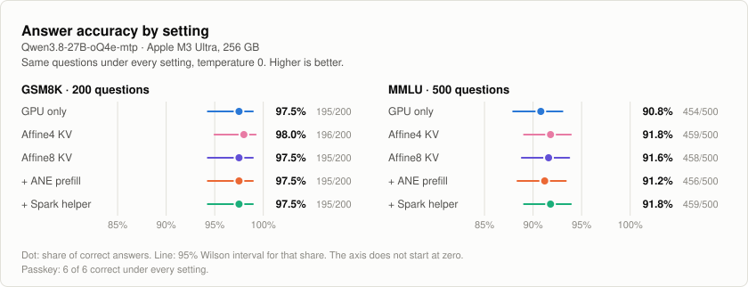
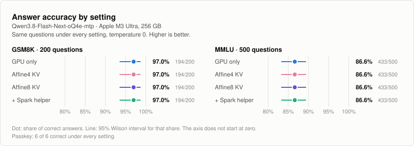

# Answer quality: does the Spark change the answers?

Question: do the settings and the Spark change what the model answers?

Short answer: not in a way these 700 questions can see. On Mac B every answer came out the same under
all four settings, and that is not a measured safety margin. On Mac A 10 or 11 of 700 answers changed
against Mac alone even where the add-on did no work, so changes that small happen on their own.

Words on this page:

- **GSM8K**: 200 grade-school maths questions, scored on the final number.
- **MMLU**: 500 general-knowledge multiple-choice questions, 25 from each of 20 subjects.
- **passkey**: find a hidden 7-digit number in a long text; there are 6 of these prompts.
- **helper**: the DGX Spark that reads long prompts for the Mac.
- **temperature 0**: the server picks the same word every time, so a question gets the same answer twice.
- **4-bit prompt memory (Affine4)** and **8-bit prompt memory (Affine8)**: the prompt memory stored
  in fewer bits, so it is smaller.

## The questions

700 questions, asked the same way under every setting, at temperature 0: 200 from GSM8K, 500 from
MMLU, and 6 passkey prompts (a 7-digit number planted halfway into 32K, 64K and 128K tokens of
filler). Mac A made 3,530 requests and Mac B 2,824, with 0 errors.

<!-- BEGIN GENERATED: quality m3-ultra-a -->
<picture>
  <source media="(prefers-color-scheme: dark)" srcset="../charts/m3-ultra-a-quality-dark.svg">
  
</picture>

### Mac A (Qwen 27B)

Answers right, per question set and setting. The second figure in a row is the share right.

| Setting | GSM8K (of 200) | MMLU (of 500) | Passkey (of 6) | Answers that changed |
|---|---:|---:|---:|---:|
| Mac alone | 195 · 97.5% | 454 · 90.8% | 6 | baseline |
| 4-bit prompt memory | 196 · 98.0% | 459 · 91.8% | 6 | 7 right answers became wrong, 13 wrong answers became right (of 700) |
| 8-bit prompt memory | 195 · 97.5% | 458 · 91.6% | 6 | 2 right answers became wrong, 6 wrong answers became right (of 700) |
| + Apple Neural Engine | 195 · 97.5% | 456 · 91.2% | 6 | 4 right answers became wrong, 6 wrong answers became right (of 700) |
| + Spark helper | 195 · 97.5% | 459 · 91.8% | 6 | 3 right answers became wrong, 8 wrong answers became right (of 700) |

- Answers that ran out of tokens while the model was still thinking, and count as wrong: Mac alone 16, 4-bit prompt memory 17, 8-bit prompt memory 12, + Apple Neural Engine 17, + Spark helper 12 (74 in all).
- Every question was asked under every setting, at temperature 0, so the same question gets the same answer twice.
<!-- END GENERATED: quality m3-ultra-a -->

<!-- BEGIN GENERATED: quality m3-ultra-b -->
<picture>
  <source media="(prefers-color-scheme: dark)" srcset="../charts/m3-ultra-b-quality-dark.svg">
  
</picture>

### Mac B (Flash-Next)

Answers right, per question set and setting. The second figure in a row is the share right.

| Setting | GSM8K (of 200) | MMLU (of 500) | Passkey (of 6) | Answers that changed |
|---|---:|---:|---:|---:|
| Mac alone | 194 · 97.0% | 433 · 86.6% | 6 | baseline |
| 4-bit prompt memory | 194 · 97.0% | 433 · 86.6% | 6 | 0 right answers became wrong, 0 wrong answers became right (of 700) |
| 8-bit prompt memory | 194 · 97.0% | 433 · 86.6% | 6 | 0 right answers became wrong, 0 wrong answers became right (of 700) |
| + Spark helper | 194 · 97.0% | 433 · 86.6% | 6 | 0 right answers became wrong, 0 wrong answers became right (of 700) |

- Answers that ran out of tokens while the model was still thinking, and count as wrong: Mac alone 57, 4-bit prompt memory 57, 8-bit prompt memory 57, + Spark helper 57 (228 in all).
- Every question was asked under every setting, at temperature 0, so the same question gets the same answer twice.
<!-- END GENERATED: quality m3-ultra-b -->

## What this means

- The 4-bit and 8-bit settings are really tested: the compression acts on every request, so all 700
  questions exercise it. Neither lowered accuracy.
- The Apple Neural Engine and the Spark are tested only by the 6 passkey prompts. The GSM8K and MMLU
  prompts are about 150 tokens, too short for either add-on to do work on, so those rows say "no work
  here", not "safe on short prompts". That is read from equal times and reading speeds; it was not
  confirmed from the server log.
- The Spark answered all 6 passkey prompts right, at 32K, 64K and 128K tokens.
- 8-bit moved 8 answers, and 4-bit moved 20, about twice as many, in both directions (7 right
  answers became wrong, 13 wrong answers became right). Read both rows as unchanged rather than as
  a gain.

## Limits

- Scores could be off by 2 to 3 points by chance. A setting that costs one point of accuracy would
  not show.
- The 20-subject MMLU subset is easier than the full test, so compare settings inside one table, not
  against published scores.
- 304 answers on Mac A ran out of tokens while the model was still thinking. They were asked again
  with a cap 8 times larger; the ones still cut off count as wrong. On Mac B 57 answers per setting
  were cut off and not asked again, so the Mac B MMLU score could be a little better than it reads,
  never worse.
- The passkey numbers come from a second run on 2026-11-17, with a unique first line in every prompt
  so that each was read cold. All 30 rows on Mac A and all 24 on Mac B read 0 cached tokens, and
  every answer was right.
- In the first passkey pass the first request with the helper at 32K took 109.7 s, and the next took
  30.9 s. That fault has a proven cause and a fix in the runner; see [helper start-up](helper-setup.md).

Full tables: [Mac A](../reports/m3-ultra-a/quality.md) and [Mac B](../reports/m3-ultra-b/quality.md).
Back to [the front page](../README.md).
