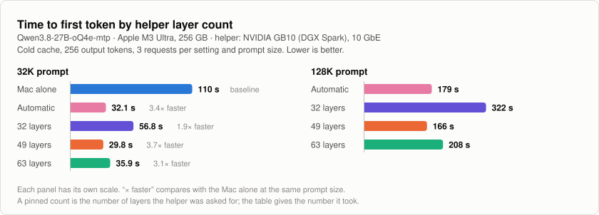

# Helper start-up and how many layers it holds

Question: why is the first request after switching the Spark on so slow, and how much of the model
should the Spark hold?

Short answer: a request sent before the helper is ready is read by the Mac alone, with no error: 6 of
6 took 109.7 s, where the same request took 29.3 s once the runner waited. The helper is fastest with
49 of the model's layers.

Words on this page:

- **helper**: the DGX Spark that reads long prompts for the Mac.
- **layer**: the model is a stack of layers, and the helper holds some of them.
- **session**: the helper's link to the loaded model, which it opens again after every settings change.
- **ready**: the state the helper reports when that session is up and stable.
- **first word**: the first token the model sends back. Every time here is the wait before it.
- **cold cache**: the server holds nothing of the prompt, so it reads all of it.

## How the two tests send a prompt

- **chat**: the same kind of call a chat page makes.
- **speed test**: the server's own built-in test call.

The first table puts each of those beside two ways of starting: at once after the switch, or after
waiting for the Spark to report ready.

<!-- BEGIN GENERATED: helper-ready m3-ultra-a -->
### Mac A (Qwen 27B)

The wait for the first word of a request at 32K with the helper on, sent straight after a switch from helper off to helper on. One line per path and per way of starting.

| Path | When the prompt was sent | Waited for the helper (s) | Wait for the first word (s) | Ran at helper speed |
|---|---:|---:|---:|---:|
| chat | Started at once | 0.0 | 109.70 to 109.76 s | 0 of 6 |
| chat | Waited for the helper | 20.1 | 29.31 to 29.93 s | 6 of 6 |
| speed test | Started at once | 0.0 | 29.52 to 30.04 s | 6 of 6 |
| speed test | Waited for the helper | 17.5 | 29.87 to 30.17 s | 6 of 6 |

- 6 requests in every line of the table. Each line is one request with the helper off and then one at 32K with the helper on, so every helper request starts straight after a switch.
- The helper state at the start of the request: chat, Started at once: not ready yet, still connecting (6 of 6); chat, Waited for the helper: ready (6 of 6); speed test, Started at once: not ready yet, still starting (6 of 6); speed test, Waited for the helper: ready (6 of 6).
- These 6 started before the helper was ready, so we do not count them. They are the speed test / Started at once rows, and they ran at helper speed (29.52 to 30.04 s).
- Every request read its prompt cold; 12 of 12 answers were correct.
<!-- END GENERATED: helper-ready m3-ultra-a -->

<!-- BEGIN GENERATED: helper-layers m3-ultra-a -->
<picture>
  <source media="(prefers-color-scheme: dark)" srcset="../charts/m3-ultra-a-helper-layers-dark.svg">
  
</picture>

### Mac A (Qwen 27B)

The wait for the first word per helper layer count, and how many times faster than the Mac alone at 32K. A layer is a slice of the model the helper holds.

| Setting | 32K wait for the first word | 128K wait for the first word | Layers on the helper | Faster than the Mac alone at 32K |
|---|---:|---:|---:|---:|
| Mac alone | 109.7 s, 109.69 to 109.72 s | not run | none | baseline |
| Automatic | 32.1 s, 29.42 to 33.62 s | 178.7 s (3.0 min), 177.96 to 179.42 s | 32K: 49; 128K: 50, 49, 49 | 3.4× |
| 32 layers | 56.8 s, 56.77 to 56.91 s | 321.6 s (5.4 min), 321.54 to 321.69 s | 32 | 1.9× |
| 49 layers | 29.8 s, 29.50 to 29.91 s | 166.0 s (2.8 min), 165.71 to 166.40 s | 49 | 3.7× |
| 63 layers | 35.9 s, 35.43 to 36.23 s | 208.2 s (3.5 min), 207.43 to 209.25 s | 63 | 3.1× |

- Each figure is the mean of 3 requests, with the smallest and largest after it.
- All 27 requests read their prompt cold and got a correct answer.
<!-- END GENERATED: helper-layers m3-ultra-a -->

## What this means

- Waiting for the helper is the whole fix: the same 32K request goes from 109.7 s to 29.3 s.
- 49 layers is the fastest setting at both sizes: 29.8 s at 32K and 166.0 s at 128K.
- Fewer layers (32) or more (63) are slower at both sizes, so more is not better.
- The automatic choice picks 49 layers, and once 50, so it is a fair default; pinning 49 layers buys
  the steadiest result.

## The cause of the slow first request

A settings change unloads the model and loads it again, and the Spark then starts a new session that
attaches to the loaded model. If you send a prompt right after a settings change, the Spark is not
ready yet, so the Mac reads it alone and shows no error. The runner now asks the model for one token,
waits until the Spark reports ready and holds it, and records the state in every row. The server's
own speed-test call did not show the fault: its requests began while the Spark was starting and still
came back at Spark speed.

## Limits

- One model on one machine pair, 3 requests per setting: enough to rank these five settings, not
  enough to separate two of them that differ by a few percent.
- The layer count in the table is what the helper really held, read after the request. The count it
  was asked for is recorded beside every request in the full table.

Full tables: [helper start-up](../reports/m3-ultra-a/helper-ready.md) and
[layers](../reports/m3-ultra-a/helper-layers.md). Back to [the front page](../README.md).
