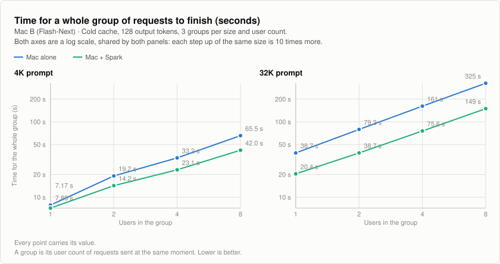

# Many people sending prompts at the same time

Question: what happens when several people send a long prompt at the same moment?

Short answer: the whole group finishes sooner with the Spark. On Mac B at 32K and 8 users the group
takes 5.4 min on the Mac alone and 2.5 min with the Spark, 2.17 times faster. One user at 4K gains
1.10 times, so a single short prompt gains least.

Words on this page:

- **helper**: the DGX Spark that reads long prompts for the Mac.
- **group**: the requests that start at the same moment; the group's time is its last reply.
- **user**: one request of a group. Eight users means eight requests sent together.
- **prompt size**: how long each prompt is, 4K or 32K tokens. 1K tokens is about 750 words.
- **first word**: the first token the model sends back. Every time here is the wait before it.
- **cold cache**: the server holds nothing of the prompt, so it reads all of it.

<!-- BEGIN GENERATED: many-users m3-ultra-b -->
<picture>
  <source media="(prefers-color-scheme: dark)" srcset="../charts/m3-ultra-b-many-users-dark.svg">
  
</picture>

### Mac B (Flash-Next)

Time for a whole group of requests to finish, at each prompt size and user count. A group is its user count of requests sent at the same moment. Lower is better.

| Prompt size | Users | Mac alone | Mac + Spark | Faster by |
|---|---:|---:|---:|---:|
| 4K | 1 | 7.9 s | 7.2 s | 1.10× |
| 4K | 2 | 19.2 s | 14.2 s | 1.35× |
| 4K | 4 | 33.2 s | 23.1 s | 1.44× |
| 4K | 8 | 65.5 s | 42.0 s | 1.56× |
| 32K | 1 | 38.7 s | 20.4 s | 1.90× |
| 32K | 2 | 79.2 s | 38.7 s | 2.05× |
| 32K | 4 | 161.3 s (2.7 min) | 75.6 s | 2.13× |
| 32K | 8 | 324.7 s (5.4 min) | 149.5 s (2.5 min) | 2.17× |

- Mean of 3 groups per case, at 1, 2, 4 and 8 users per group.
- A group with a request a check marks not valid is left out of the group means as a whole: its own time and prompt tokens are not used in any mean.
- All 180 requests read their prompt cold and got a correct answer.
<!-- END GENERATED: many-users m3-ultra-b -->

## What this means

- A group is N requests that start at the same instant, and its time is the wait of the slowest one.
- The longer the prompt and the more users, the more the Spark is worth: 1.10 times at 4K with one
  user, 2.17 times at 32K with eight.
- On the Mac alone the group time roughly doubles each time the user count doubles. With the Spark it
  also rises at every step, but by less.
- These rows do not say how the Mac and the Spark share the work between users. That was not measured.

## Limits

- One model, one machine pair, 3 groups per case, 128 output tokens, a cold cache in every request.
- The second, fourth and eighth user send at the same instant as the first; real users send at
  different times.
- The rows were made on 2026-11-18 with the Spark that was paired with that Mac that day, not the
  second Spark of the same type used for the prompt-size test.

Full table: [Mac B, every request](../reports/m3-ultra-b/many-users.md). Back to
[the front page](../README.md).
