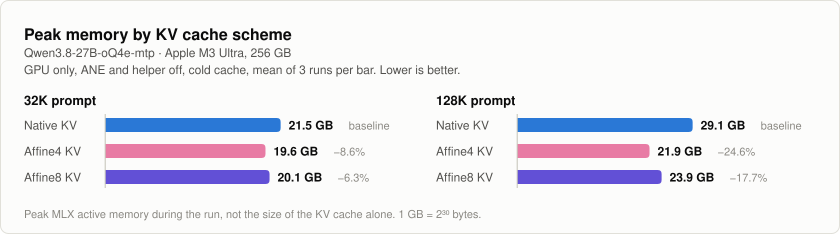
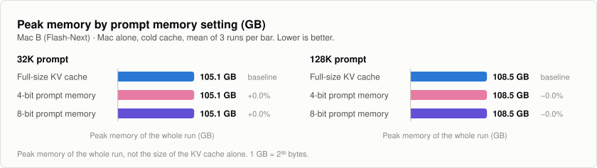

# Memory: what the prompt memory costs

Question: does a smaller prompt memory save memory, and what does it cost in speed?

Short answer: on Mac A, storing the prompt memory in 4 bits saves 24.6% of peak memory at 128K tokens
and costs no speed. Neither setting changed memory or speed on Mac B.

Words on this page:

- **KV cache**: the memory that holds the prompt while the model answers.
- **prompt memory**: another name for the KV cache, used for the settings below.
- **full-size**: the prompt memory kept at its full size, the setting the others are compared with.
- **4-bit prompt memory (setting name: Affine4)**: the same memory stored in 4 bits instead of 16, so
  it is smaller.
- **8-bit prompt memory (setting name: Affine8)**: the same idea, stored in 8 bits.
- **peak memory**: the most memory the whole run used, not the size of the KV cache alone.
- **layer**: the model is a stack of layers, and a setting may compress only some of them.

<!-- BEGIN GENERATED: kv-cache m3-ultra-a -->
<picture>
  <source media="(prefers-color-scheme: dark)" srcset="../charts/m3-ultra-a-kv-memory-dark.svg">
  
</picture>

### Mac A (Qwen 27B)

The KV cache is the memory that holds the prompt. The second figure in a row is the change against Full-size KV cache.

| KV cache | 32K peak memory | 32K wait for the first word | 128K peak memory | 128K wait for the first word |
|---|---:|---:|---:|---:|
| Full-size KV cache | 21.5 GB | 109.9 s | 29.1 GB | 638.2 s (10.6 min) |
| 4-bit prompt memory | 19.6 GB · −8.6% | 109.0 s · −0.7% | 21.9 GB · −24.6% | 621.0 s (10.3 min) · −2.7% |
| 8-bit prompt memory | 20.1 GB · −6.3% | 109.0 s · −0.8% | 23.9 GB · −17.7% | 621.4 s (10.4 min) · −2.6% |

- Peak memory is the most memory the whole run used, not the size of the KV cache alone.
- Each figure is the mean of 3 valid runs. Repeat runs differed by at most 0.07% in reading speed.
<!-- END GENERATED: kv-cache m3-ultra-a -->

<!-- BEGIN GENERATED: kv-cache m3-ultra-b -->
<picture>
  <source media="(prefers-color-scheme: dark)" srcset="../charts/m3-ultra-b-kv-memory-dark.svg">
  
</picture>

### Mac B (Flash-Next)

The KV cache is the memory that holds the prompt. The second figure in a row is the change against Full-size KV cache.

| KV cache | 32K peak memory | 32K wait for the first word | 128K peak memory | 128K wait for the first word |
|---|---:|---:|---:|---:|
| Full-size KV cache | 105.1 GB | 33.5 s | 108.5 GB | 137.7 s (2.3 min) |
| 4-bit prompt memory | 105.1 GB · +0.0% | 33.6 s · +0.4% | 108.5 GB · −0.0% | 137.6 s (2.3 min) · −0.1% |
| 8-bit prompt memory | 105.1 GB · +0.0% | 33.6 s · +0.3% | 108.5 GB · −0.0% | 137.9 s (2.3 min) · +0.1% |

- Peak memory is the most memory the whole run used, not the size of the KV cache alone.
- Each figure is the mean of 3 valid runs. Repeat runs differed by at most 1.47% in reading speed.
<!-- END GENERATED: kv-cache m3-ultra-b -->

## What this means

- On Mac A, 4-bit is the better of the two settings: less memory at both sizes, and the same speed.
- 8-bit saves less memory than 4-bit on that Mac, and equals it on speed.
- On Mac B neither setting changed peak memory (105.1 GB at 32K, 108.5 GB at 128K) or the wait.
- The memory figure is the peak of the whole run, not the size of the KV cache, so no KV cache size is
  claimed here.

## One thing not explained

On Mac A both settings convert 16 of the model's 64 layers, and each row records it. On Mac B no row
records a conversion, though the server accepted the setting. From these rows it is not possible to
say whether that model does not convert or the server log does not show it.

Full tables: [Mac A](../reports/m3-ultra-a/kv-cache.md) and [Mac B](../reports/m3-ultra-b/kv-cache.md).
Back to [the front page](../README.md).
