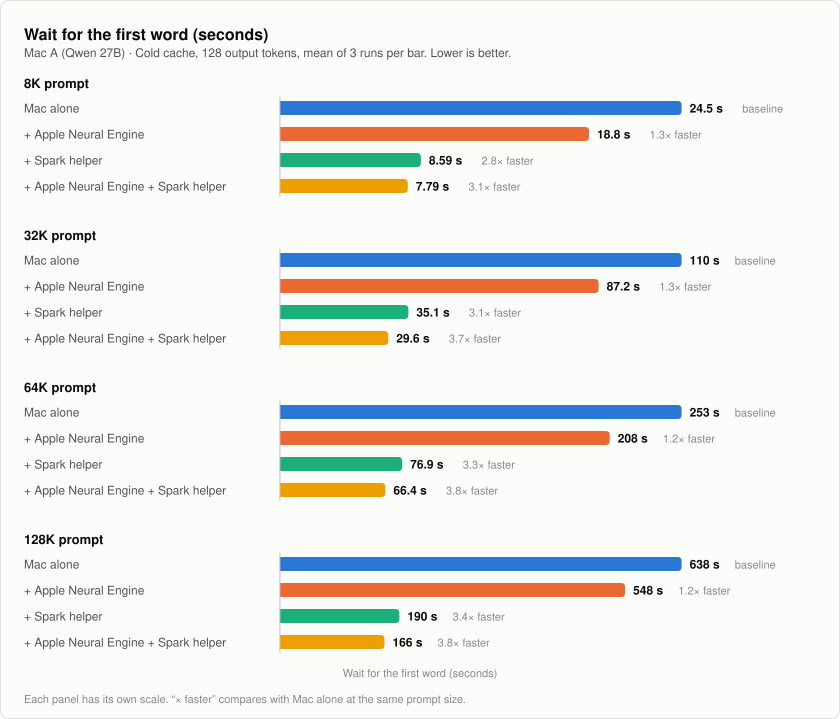
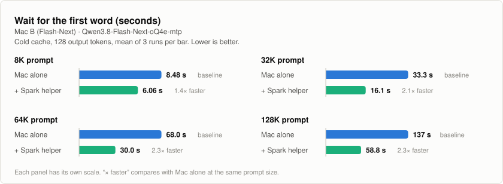
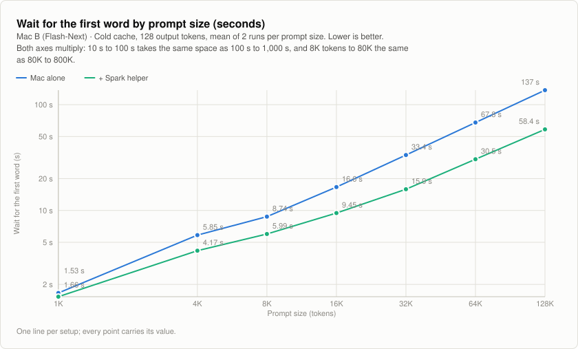

# Speed: how long does a Mac make you wait?

Question: how long do you wait for the first word of a long prompt, and how much does the Spark take off?

Short answer: on Mac A the Spark cuts the wait 2.8 to 3.4 times, from 8K to 128K tokens. On Mac B it
cuts 1.4 times at 8K and 2.3 times at 128K. The Apple Neural Engine alone gives 1.2 to 1.3 times, and
the two together give 3.1 to 3.8 times.

Words on this page:

- **helper**: the DGX Spark that reads long prompts for the Mac.
- **token**: about 3/4 of a word, so 128K tokens is about 100,000 words.
- **first word**: the first token the model sends back. Every time here is the wait before it.
- **cold cache**: the server holds nothing of the prompt, so it reads all of it.
- **Apple Neural Engine**: a part of the Apple chip that can read part of a prompt as well.
- **setup**: one way of running the server, for example with the Spark helping.

<!-- BEGIN GENERATED: speed m3-ultra-a -->
<picture>
  <source media="(prefers-color-scheme: dark)" srcset="../charts/m3-ultra-a-ttft-dark.svg">
  
</picture>

### Mac A (Qwen 27B)

The wait for the first word, in seconds. The second figure is how many times shorter the wait is than on the Mac alone.

| Setup | 8K | 32K | 64K | 128K |
|---|---:|---:|---:|---:|
| Mac alone | 24.5 s | 109.8 s | 252.8 s (4.2 min) | 638.1 s (10.6 min) |
| + Apple Neural Engine | 18.8 s · 1.3× | 87.2 s · 1.3× | 207.5 s (3.5 min) · 1.2× | 548.3 s (9.1 min) · 1.2× |
| + Spark helper | 8.6 s · 2.8× | 35.1 s · 3.1× | 76.9 s · 3.3× | 189.8 s (3.2 min) · 3.4× |
| + Apple Neural Engine + Spark helper | 7.8 s · 3.1× | 29.6 s · 3.7× | 66.4 s · 3.8× | 166.1 s (2.8 min) · 3.8× |

Reading the prompt, in tokens per second:

| Setup | 8K | 32K | 64K | 128K |
|---|---:|---:|---:|---:|
| Mac alone | 335 | 298 | 259 | 205 |
| + Apple Neural Engine | 435 | 376 | 316 | 239 |
| + Spark helper | 955 | 933 | 852 | 691 |
| + Apple Neural Engine + Spark helper | 1,052 | 1,106 | 987 | 789 |

- Each figure is the mean of 3 valid runs. Every run read its prompt with a cold cache (0 cached tokens).
- Repeat runs differed by at most 2.9% in reading speed except + Spark helper at 8K (7.5%), + Spark helper at 32K (4.3%).
- Run again back to back, 3 runs each: + Spark helper at 8K: 1,004 tokens/s (955 in the first pass), + Spark helper at 32K: 1,094 tokens/s (933 in the first pass).
<!-- END GENERATED: speed m3-ultra-a -->

<!-- BEGIN GENERATED: speed m3-ultra-b -->
<picture>
  <source media="(prefers-color-scheme: dark)" srcset="../charts/m3-ultra-b-ttft-dark.svg">
  
</picture>

### Mac B (Flash-Next)

The wait for the first word, in seconds. The second figure is how many times shorter the wait is than on the Mac alone.

| Setup | 8K | 32K | 64K | 128K |
|---|---:|---:|---:|---:|
| Mac alone | 8.5 s | 33.3 s | 68.0 s | 137.2 s (2.3 min) |
| + Spark helper | 6.1 s · 1.4× | 16.1 s · 2.1× | 30.0 s · 2.3× | 58.8 s · 2.3× |

Reading the prompt, in tokens per second:

| Setup | 8K | 32K | 64K | 128K |
|---|---:|---:|---:|---:|
| Mac alone | 966 | 983 | 963 | 955 |
| + Spark helper | 1,353 | 2,030 | 2,185 | 2,230 |

- Each figure is the mean of 3 valid runs. Every run read its prompt with a cold cache (0 cached tokens).
- Repeat runs differed by at most 2.9% in reading speed except + Spark helper at 32K (4.1%).
<!-- END GENERATED: speed m3-ultra-b -->

<!-- BEGIN GENERATED: speed-sweep m3-ultra-b -->
<picture>
  <source media="(prefers-color-scheme: dark)" srcset="../charts/m3-ultra-b-ttft-sweep-dark.svg">
  
</picture>

### Mac B (Flash-Next)

The wait for the first word at each prompt size, and how many times shorter it is with the helper.

| Prompt size | Mac alone | + Spark helper | Faster by |
|---|---:|---:|---:|
| 1K | 1.7 s | 1.5 s | 1.1× |
| 4K | 5.8 s | 4.2 s | 1.4× |
| 8K | 8.7 s | 6.0 s | 1.5× |
| 16K | 16.6 s | 9.5 s | 1.8× |
| 32K | 33.4 s | 15.9 s | 2.1× |
| 64K | 67.8 s | 30.5 s | 2.2× |
| 128K | 137.1 s (2.3 min) | 58.4 s | 2.3× |

- Each figure is the mean of 2 valid runs. Every run read its prompt with a cold cache (0 cached tokens).
<!-- END GENERATED: speed-sweep m3-ultra-b -->

## In what order the runs went

Every setup ran once at every prompt size, then every setup again, then a third time. Heat, and any
slowing during the run, land on every setup alike.

## What this means

- The Spark pays best on long prompts, because reading the prompt is what takes the time.
- Mac B already reads a prompt fast on its own, so the same Spark buys less there.
- The Apple Neural Engine helps a little on its own, and its gain adds to the Spark's.
- At 128K tokens the helper read the whole prompt with no drop and no restart. On the stock helper
  that run fails; the fix is in [pull request 5271](https://github.com/jundot/omlx/pull/5271), not
  released yet.

## Two helper results that are wide

At 8K and 32K on Mac A the first pass of helper runs came out lower than the rerun. The cause: a
helper run that starts after several minutes of Mac-only work is slower than one that follows other
helper runs. Both figures are in the tables above. Treat the first pass as the lower bound.

## About the prompt-size test on Mac B

It was measured a day before the speed table, with a second Spark of the same type and 2 runs per
size, so read it as its own series. The four sizes both sets have agree to within 3.1%. Four rows in
those two files are kept but marked not valid, and none is in a mean: one 128K helper run never
reached the helper, two runs were refused because the server was busy, and one failed before the
rerun.

Full tables: [Mac A](../reports/m3-ultra-a/speed.md) and [Mac B](../reports/m3-ultra-b/speed.md).
The prompt sizes on Mac B are in [the prompt-size table](../reports/m3-ultra-b/speed-sweep.md). Back
to [the front page](../README.md).
